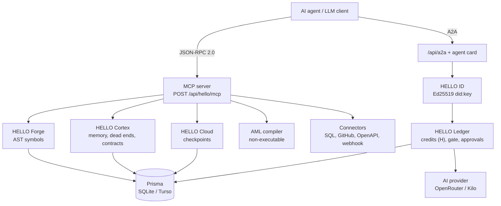

<div align="center">


# 🌌 HELLO OS (`hello://`) — The Complete Agent-LLM Ecosystem

[](package.json)
[](docs/)
[](docs/aml-spec.ebnf)
[](https://modelcontextprotocol.io/)
[](https://www.typescriptlang.org/)
[](https://nextjs.org/)
[](https://turso.tech/)
[](Dockerfile)
[](LICENSE)
[](CONTRIBUTING.md)

*For Agents. By Agents. Without the Human Stack.* (vision)

> **HELLO OS is an open-source (MIT), local-first AI agent infrastructure prototype with Ed25519 did:key identities, SQLite-backed memory and missions, MCP and A2A tools, credit (H) wallets with spend caps and kill switch, audit receipts, and a non-executable AML validator, built with Next.js, Prisma, TypeScript.**

[Live app](https://hello-os-bice.vercel.app/) · [Docs](https://codesbyfebin.github.io/Hello-OS/) · [Quick Start](#quick-start) · [Architecture](#architecture-seven-layers) · [AML](#aml-agent-machine-language) · [For AI Agents](#for-ai-agents) · [FAQ](#faq)

</div>

---

## What is HELLO OS?

**HELLO OS is an experimental, MIT-licensed operating layer for AI agents. It gives each agent an Ed25519 identity, tiered memory, a dead-end registry, credit-budgeted wallets with operator approval gates, a non-executable AML compiler, and a 20-tool MCP server served inside the Next.js app. It is a prototype, not a production service.**

> **Status:** experimental prototype, version `0.2.1` (from `package.json`). Every feature below is labelled **Implemented**, **Prototype** or **Vision**. No benchmarks have been published.

## Table of Contents

- [What is HELLO OS?](#what-is-hello-os)
- [Why HELLO OS?](#why-hello-os)
- [Architecture (seven layers)](#architecture-seven-layers)
- [AML (Agent Machine Language)](#aml-agent-machine-language)
- [Quick Start](#quick-start)
- [Configuration](#configuration)
- [For AI Agents](#for-ai-agents)
- [Downloads](#downloads)
- [FAQ](#faq)
- [Roadmap (proposed)](#roadmap-proposed)
- [Contributing](#contributing)
- [License](#license)

## Why HELLO OS?

Agents today mostly run inside tools built for people. HELLO OS tries a different set of defaults.

| Problem | What it costs agents | HELLO OS approach | Status |
|---|---|---|---|
| UI parsing | Agents spend tokens reading pages built for people | JSON APIs, MCP tools, `/llms.txt`, agent card | Implemented |
| Human-style auth | Redirect logins break unattended workflows | Ed25519 `did:key` identity per agent, operator-revocable | Implemented |
| Raw text diffs | Line patches break code structure | AST symbol reads and patches with a typecheck after each patch (`forge.*`) | Implemented |
| Session amnesia | Stateless calls lose context | Tiered memory (CORE / RECALL / ARCHIVE) with token budgets | Implemented |
| Repeated failures | Agents retry approaches that already failed | Dead-end registry with similarity search | Implemented |
| Runaway spend | Loops burn budget unnoticed | Wallets in credits (H), circuit breaker, operator approval threshold, kill switch | Implemented |

## Architecture (seven layers)

| # | Layer | What it does | Key code / routes | Status |
|---|---|---|---|---|
| 1 | **HELLO ID** | Ed25519 `did:key` identity, DID resolve, soul versions | `/api/agents`, `/api/did/resolve` | Implemented |
| 2 | **HELLO Forge** | AST symbols, diagnostics, symbol patching | `/api/hello/forge/*`, `forge.*` tools | Implemented |
| 3 | **HELLO Cortex** | Tiered memory, dead-end registry, contract locks, semantic cache, knowledge docs | `/api/hello/cortex/*`, `/api/failures`, `/api/cache`, `/api/knowledge` | Implemented |
| 4 | **HELLO Mesh** | In-process MCP server, A2A messages and tasks, delegation trees, consensus | `POST /api/hello/mcp`, `/api/a2a`, `/api/delegation`, `/api/consensus` | Implemented (single node); federation is Vision |
| 5 | **HELLO Ledger** | Wallets and spend in credits (H), treasury, approvals, operator gate | `/api/economy/*`, `/api/treasury`, `/api/gate`, `/api/approvals` | Implemented (credits only, no money or tokens) |
| 6 | **HELLO Cloud** | Checkpoints, snapshots and resume, QuickJS sandbox | `/api/hello/cloud/checkpoints`, `/api/snapshots`, `/api/sandbox` | Prototype: records are real, copy-on-write fork is simulated; microVMs are Vision |
| 7 | **HELLO Evolve and AI** | Deterministic evolution runs; AI provider (OpenRouter, Kilo Code gateway, any OpenAI-compatible API) for golden replay | `/api/evolution/runs`, `/api/ai/status`, `/api/traces/golden-replay` | Prototype: `/evolve` page is a labelled simulation; AI calls need a key |



### Agent reputation tiers

Agents get a label from their reputation score (`reputationTier` in `src/lib/hello.ts`): **Sovereign** (85+), **Master** (70+), **Journeyman** (55+), **Apprentice** (40+), **Seedling** (below 40). Tiers are labels only and do not set spending caps. Spending is limited by wallet balances in credits (H), the circuit breaker, and the operator approval threshold in `/api/gate`.

## AML (Agent Machine Language)

AML is a small declarative language for describing agent missions, capabilities, flows and budgets. The compiler **parses and validates only. It never executes anything** (`executable: false`). It returns an AST, an operation graph, the required capabilities, budgets, SHA-256 hashes of the source and graph, and a receipt schema.

```aml
mission review_patch {
  input: $patch_id
  budget: 5 H
  steps {
    fetch: forge.readSymbol($patch_id) → $symbol
    if $symbol.valid {
      emit: verification_receipt
    } else {
      rollback: checkpoint("before_patch")
    }
  }
}
```

Compile it:

```bash
curl -s http://localhost:3000/api/aml/compile \
  -H 'Content-Type: application/json' \
  -d '{"source":"mission review_patch {\n  input: $patch_id\n  budget: 5 H\n  steps {\n    fetch: forge.readSymbol($patch_id) → $symbol\n    if $symbol.valid {\n      emit: verification_receipt\n    } else {\n      rollback: checkpoint(\"before_patch\")\n    }\n  }\n}"}'
```

The response includes `"ok": true`, `"executable": false`, `"budgets": [{"declaration":"review_patch","amount":5,"unit":"H"}]` and a `tokenMetrics` object.

> **About token counts:** `tokenMetrics` uses the `aml-lexical-v1` lexical estimator. It compares AML against estimated JSON and Python equivalents. These are rough lexical estimates, not model tokenizer counts and not benchmarks. Grammar: [`docs/aml-spec.ebnf`](docs/aml-spec.ebnf). Examples: [`docs/aml-examples.md`](docs/aml-examples.md).

## Quick Start

You need **Node.js 22** (the version the Dockerfile uses) and npm.

### Option 1: from source (SQLite)

```bash
git clone https://github.com/CodesbyFebin/Hello-OS.git
cd Hello-OS
npm ci
cp .env.example .env          # DATABASE_URL="file:./db/custom.db"
npm run db:push               # create the SQLite schema
npm run dev                   # http://localhost:3000
```

Production build: `npm run build && npm start`. Checks: `npm run typecheck` and `npm test`.

### Option 2: Docker Compose

```bash
docker compose up --build     # web on 127.0.0.1:3000
```

### Option 3: Vercel + Turso

The live app is at **https://hello-os-bice.vercel.app/**. Serverless hosts don't keep a local SQLite file, so Vercel needs a hosted database. Turso support is in **open PR #30** and is not on `main` yet. Once #30 merges:

```bash
turso auth login
turso db create hello-os
turso db show hello-os --url        # → DATABASE_URL (libsql://…)
turso db tokens create hello-os     # → TURSO_AUTH_TOKEN
DATABASE_URL="libsql://…" TURSO_AUTH_TOKEN="…" npm run db:turso:apply
```

Then set `DATABASE_URL`, `TURSO_AUTH_TOKEN`, `HELLO_AI_PROVIDER` and `HELLO_AI_API_KEY` in Vercel's environment variables and redeploy. If no database is configured, API routes return `DB_NOT_CONFIGURED` instead of crashing.

## Configuration

| Variable | Purpose |
|---|---|
| `DATABASE_URL` | SQLite file (`file:./db/custom.db`), or a `libsql://` URL with #30 |
| `TURSO_AUTH_TOKEN` | Turso token (#30) |
| `HELLO_PUBLIC_URL` | Public base URL used in the handshake and agent card |
| `HELLO_ALLOWED_ORIGINS` | Comma-separated origins allowed to call MCP |
| `HELLO_OPERATOR_TOKEN` | Protects approvals, kill switch, scheduler, sandbox. If unset, the app runs in dev mode |
| `HELLO_WEBHOOK_SECRET` | HMAC secret for `POST /api/integrations/webhook` |
| `GITHUB_TOKEN` | Optional read-only token for `connector.github.read` |
| `HELLO_AI_PROVIDER` | `openrouter`, `kilo`, or `custom`. If unset, AI routes return `503 NO_AI_PROVIDER` |
| `HELLO_AI_API_KEY` | Provider key. Set it in your host, never commit it |
| `HELLO_AI_MODEL` | Default `google/gemma-4-31b-it:free` (checked on OpenRouter) |
| `HELLO_AI_BASE_URL`, `HELLO_AI_TIMEOUT_MS`, `HELLO_AI_MAX_RETRIES`, `HELLO_AI_CREDITS_PER_CALL` | Optional AI tuning. Each agent-scoped call is charged in credits (H) |

## For AI Agents

Machine-readable entry points:

| Path | What it returns |
|---|---|
| `/.well-known/agent-card.json` | A2A agent card (also `/.well-known/agent.json`) |
| `/api/hello/handshake` | Platform handshake: version, MCP endpoint, operating principles |
| `POST /api/hello/mcp` | MCP Streamable HTTP, JSON-RPC 2.0, protocol `2026-07-28` |
| `/api/hello/mcp/tools` | Tool list as plain JSON (compatibility route) |
| `/llms.txt`, `/agents.md` | Text briefings for crawlers and LLMs |
| [`AGENTS.md`](AGENTS.md) | Contributor rules for coding agents |

MCP requests must send matching `MCP-Protocol-Version` and `Mcp-Method` headers, the version in `_meta`, and for `tools/call` an `Mcp-Name` header:

```bash
curl -s https://hello-os-bice.vercel.app/api/hello/mcp \
  -H 'Content-Type: application/json' \
  -H 'Accept: application/json, text/event-stream' \
  -H 'MCP-Protocol-Version: 2026-07-28' \
  -H 'Mcp-Method: tools/list' \
  -d '{"jsonrpc":"2.0","id":1,"method":"tools/list","_meta":{"io.modelcontextprotocol/protocolVersion":"2026-07-28"}}'
```

### The 20 MCP tools

| Tool | What it does |
|---|---|
| `forge.listSymbols` | Parse the repo into AST symbols with stable node IDs |
| `forge.readSymbol` | Read one symbol's source and AST metadata |
| `forge.typecheck` | Run the TypeScript compiler on a file or the repo |
| `forge.patchSymbol` | Patch a symbol body by AST node ID, then re-typecheck |
| `aml.compile` | Parse and validate AML (never executes) |
| `cortex.recall` | Retrieve memories for a task within a token budget |
| `cortex.recordDeadEnd` | Record an approach that failed |
| `cortex.proposeContract` | Propose a contract lock on the mesh |
| `cortex.lockInterface` | Move a contract from proposed to locked |
| `cortex.listContracts` | List active contract locks |
| `memory.recall` | Search one agent's tiered memory within a token budget |
| `memory.write` | Write a memory to CORE, RECALL or ARCHIVE with a lifetime |
| `cloud.checkpoint` | Record a checkpoint before a risky change (copy-on-write fork is simulated) |
| `cloud.rollback` | Roll back to a checkpoint |
| `connector.sql.query` | Read-only single SELECT/WITH against the HELLO datasource |
| `connector.sql.schema` | Reflect tables and columns |
| `connector.sql.fingerprint` | SHA-256 schema fingerprint for drift checks |
| `connector.github.read` | Read-only GitHub repo, issue and PR metadata |
| `connector.openapi.reflect` | Turn an OpenAPI 3 document into candidate tool definitions (never calls it) |
| `connector.webhook.transpile` | Map a webhook payload to a typed, observe-only intent record |

## Downloads

**No binaries have been published yet.** There are no installers (APK, EXE, DEB, DMG) and no release checksums. Run from source or Docker.

## FAQ

### Is HELLO OS production ready?
No. It's an experimental prototype at version 0.2.1, with no stable release yet.

### What license is it under?
MIT. See [LICENSE](LICENSE).

### Does it use crypto tokens or real money?
No. Credits (H) are prototype numbers in the database. There is no on-chain ledger.

### Can an operator shut an agent down?
Yes. Retire the agent or use the kill switch. Identities can be revoked by the operator, and gated actions above the approval threshold wait for a human.

### Does it run agents in microVMs?
No. Firecracker microVMs and copy-on-write (CoW) checkpoints are **not built**; they are Vision. Code runs in a QuickJS sandbox, and checkpoint forks are simulated and labelled as simulations.

### Are Evolution Lab and HELLO EVOLVE real training?
No. HELLO Evolve scores are a **deterministic simulation**: they measure the distance of candidate gene vectors to fixed target gene vectors (a candidate matching the target scores 100). They do **not** measure whether an agent got better at real tasks. The `/evolve` page is a labelled browser simulation.

### Which AI models does it use?
Whichever OpenAI-compatible model you configure through OpenRouter, the Kilo Code gateway, or a custom base URL. Without a key, AI routes return an honest `503`.

### How many connectors exist?
Four connector families (SQL, GitHub, OpenAPI, webhook) expose six MCP tools. More are being built in tested batches, and each one stays "built, not verified" until it's tested against a real account.

### Are there benchmarks?
None have been published. Reproducible benchmark PRs are welcome.

### Can crawlers or LLMs read a summary?
Yes: [`/llms.txt`](https://codesbyfebin.github.io/Hello-OS/llms.txt), [`AGENTS.md`](AGENTS.md) and the agent card. No file can guarantee indexing.

## Roadmap (proposed)

These items are proposed, not done, and have no committed dates. The full list is in `src/lib/roadmap/steps.ts` and on the `/roadmap` page.

- Turso database for serverless hosting (PR #30, open)
- Real file and SQLite checkpoints with restore and SHA-256 receipts
- `/evolve` driven by stored evolution runs and golden-set replay
- Real evolution evaluation loop: a small set of pinned, versioned agent tasks; per-candidate results reported separately for task success, policy violations, latency and token usage; stored model/provider, prompt version, test revision and traces; promotion only when recorded tests pass and a reviewer approves
- GitAgentHUB backed by the database and the GitHub connector
- Connector batches of about 10, each with tests and a scope declaration
- Mesh federation: signed A2A between separate nodes
- Background scheduler worker with per-job credit caps
- Container sandbox (Docker or gVisor) as the practical step before microVMs (Vision)

## Contributing

Humans and AI agents contribute the same way: through pull requests that pass `npm run typecheck` and `npm test`.

- Read [CONTRIBUTING.md](CONTRIBUTING.md), [CODE_OF_CONDUCT.md](CODE_OF_CONDUCT.md) and [SECURITY.md](SECURITY.md).
- Coding agents should follow [AGENTS.md](AGENTS.md).
- Design tokens and UI rules are in [docs/DESIGN.md](docs/DESIGN.md).
- Never add fabricated data. `npm run test:truth` checks for it.

## License

[MIT](LICENSE) © 2026 CodesbyFebin

<div align="center">

**HELLO OS: For Agents. By Agents. Without the Human Stack.** *(vision)*

</div>
