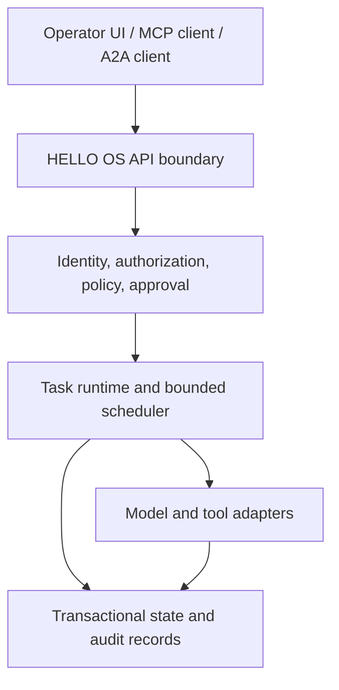
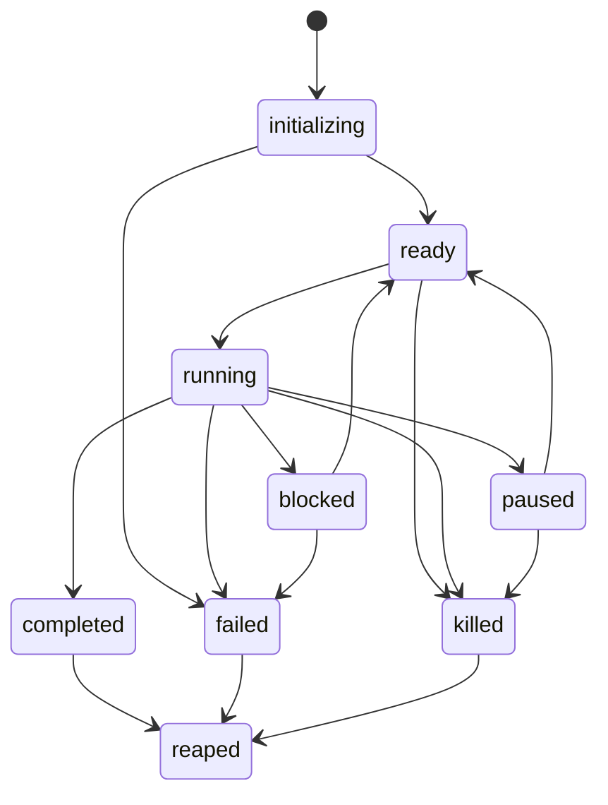

# HELLO OS Agent Runtime Architecture v1

**Status:** design proposal for future work. This document does not describe a deployed kernel or promise a delivery date.  
**Product:** HELLO OS. The project name, repository identity, URLs, package names, and UI remain HELLO OS.  
**Current baseline:** a local-first Next.js application with Prisma persistence, selected MCP-compatible tools, A2A-style task records, agent identities, memories, wallet credits, approval controls, and a static AML compiler. See [the capability matrix](../CAPABILITIES.md) and [the current architecture](../wiki/Architecture.md) for shipped behavior.

## 1. Purpose and design boundary

HELLO OS explores an agent-first runtime: agents are durable, inspectable principals with a lifecycle, narrowly granted capabilities, bounded work, managed context, and an auditable relationship to tools and people. A model proposes text and actions; the runtime validates requests, applies policy, schedules bounded work, mediates side effects, and records outcomes. The model is not the authority boundary.

This proposal extends the existing project in stages. The current web application is not an operating-system kernel, does not create isolated agent processes, and does not provide multi-node migration. Named HELLO domains describe product areas; they are not separate deployed services. Claims in this document are future design unless explicitly labelled **Current**.

### Goals

- Give each agent a stable identity, owner, lifecycle record, and reviewable capability set.
- Make each task a validated contract with explicit inputs, outputs, limits, policy, and stop conditions.
- Enforce authorization and resource limits in server-side code, independently of model prompts.
- Make memory provenance, access, retention, and context selection inspectable.
- Treat retries, duplicate messages, timeouts, partial failures, and human decisions as normal runtime events.
- Preserve protocol and provider portability through versioned, bounded interfaces.
- Ship useful local functionality before attempting multi-tenant hosting or distributed execution.

### Non-goals for v1

- A replacement for Linux, a POSIX-compatible kernel, or a claim that agents execute as hardware-isolated processes.
- Unrestricted shell, browser, file-system, network, wallet, or deployment access for an agent.
- Guaranteed deterministic model output, exactly-once network delivery, or proof that a model's claims are true.
- Firecracker, RDMA/CXL migration, cross-server memory coherence, automatic skill promotion, or a public agent marketplace in the first release.
- A claim of superiority over other agent frameworks without a reproducible, workload-specific benchmark.

## 2. Architecture overview

The first implementation should retain the existing Next.js deployment boundary and extract runtime responsibilities behind typed modules. A separate worker and a stronger database boundary come before multi-node federation. The browser is an operator surface, not a trust boundary.



| Component | Responsibility | Current state | Target boundary |
|---|---|---|---|
| API boundary | Validate transport, size, content type, authentication, and request shape | Next.js routes, MCP handler, and A2A-style routes exist | Keep transport handlers thin; route all writes through one application service |
| Identity and policy | Resolve principal, owner, grants, policy version, and required approval | Ed25519 `did:key` records and operator controls exist; production tenant isolation is absent | Explicit principal and workspace scopes; deny by default for unknown or expired grants |
| Task runtime | Persist task state, enforce transitions, limits, cancellation, and retries | Task/delegation records and scheduler tick APIs exist; there is no general durable execution worker | Durable state machine with leases, idempotent transitions, bounded retries, and recovery tests |
| Context service | Select eligible memories and assemble a bounded context package | Tiered memory and retrieval budgets exist | Provenance-aware reads, tenant checks, deterministic ordering, retention enforcement |
| Model adapters | Call configured providers and report usage/errors | One configured provider path supports selected golden-set replays | Provider-neutral request/response schema; secret isolation; actual usage reconciliation |
| Tool adapters | Validate and mediate external side effects | Selected MCP tools and read-only connectors exist | Per-tool schemas, policy checks, timeouts, idempotency, secret references, and explicit effect class |
| State and audit | Persist records and evidence of transitions | Prisma with SQLite/Turso support; SHA-256 receipts exist | Transactional inbox/outbox, append-only event history, retention, backup and restore gates |
| Operator surface | Inspect work and make exact approval decisions | Dashboard and Ops pages exist | Trusted approval view bound to the exact request digest; clear actor and policy context |

### Request path

1. An authenticated caller submits a versioned task contract or calls an existing supported endpoint.
2. The API validates the envelope, size, identifiers, schema, expiry, idempotency key, and caller identity.
3. The authorization service resolves the owner/workspace and checks current policy and capability grants.
4. If approval is required, the runtime stores a pending request with a digest of the exact proposed action and does not execute it.
5. The scheduler claims eligible work using a lease and reserves bounded resources.
6. The model may propose a next step. The runtime validates that step against the contract and policy before invoking a tool adapter.
7. Tool results are stored with provenance; usage is reconciled against the budget; task state advances through a legal transition.
8. Completion, failure, denial, cancellation, and timeout are all persisted and visible to the operator.

## 3. Agent Process Model

“Process” is a runtime abstraction in this proposal. It is a database-backed agent record plus task executions and resource leases, not an OS process or hardware protection domain.

### Process descriptor (proposed `hello.agent/v1`)

```json
{
  "schema": "hello.agent/v1",
  "agentId": "agt_01J...",
  "did": "did:key:z...",
  "ownerId": "usr_...",
  "workspaceId": "wsp_...",
  "parentAgentId": null,
  "modelPreference": { "provider": "configured-provider", "model": "configured-model" },
  "capabilityGrantIds": [],
  "autonomyLevel": 0,
  "quotaProfileId": "qpr_default",
  "state": "ready",
  "createdAt": "2026-10-23T00:00:00Z",
  "lastActivityAt": "2026-10-23T00:00:00Z",
  "version": 1
}
```

The descriptor MUST NOT contain private signing keys, raw provider credentials, or unbounded model context. Keys and credentials belong in a separate custody system. `modelPreference` is a request, not a promise that a provider is available. `autonomyLevel` has no authority unless a versioned policy maps it to explicit capabilities and approval requirements.

### Lifecycle



Every transition is conditional on the current version and actor. A compare-and-swap on the record version prevents two workers from advancing the same task concurrently. Terminal states do not become runnable again; a retry creates a new attempt linked to the original. `reaped` is archival/retention state, not proof that every external side effect was undone.

| Operation | Proposed rule |
|---|---|
| Create | Owner is explicit; defaults are conservative; requested grants are validated before the record becomes ready |
| Spawn child | Parent may delegate only a subset of active capabilities and a bounded fraction of its remaining quota |
| Pause | Stops new steps at a step boundary; records the reason and releases the worker lease |
| Resume | Rechecks policy, grant expiry, and remaining quota; it does not blindly replay a pending external side effect |
| Cancel/kill | Authorized operator or policy actor; creates a terminal event and signals workers; adapters must report uncertain external outcomes |
| Complete/fail | Terminal result includes attempt, timestamps, reason code, trace reference, and usage when available |
| Reap | Retention process removes or anonymizes eligible records according to workspace policy |

Forking, copy-on-write memory, and model-switching `exec` are future research items. A child starts with a new identity and explicit input references; it does not inherit arbitrary parent memory or authority.

## 4. Capability and delegation model

A capability is a typed permission for one class of operation against a scoped resource. It is not a natural-language claim such as “trusted” or “can use tools.” A grant should contain:

```json
{
  "schema": "hello.capability/v1",
  "grantId": "cgr_...",
  "subjectAgentId": "agt_...",
  "issuerPrincipalId": "usr_...",
  "actions": ["memory.read"],
  "resourceScope": { "workspaceId": "wsp_...", "agentIds": ["agt_..."] },
  "constraints": { "maxRecords": 20 },
  "notBefore": "2026-10-23T00:00:00Z",
  "expiresAt": "2026-10-24T00:00:00Z",
  "policyVersion": "pol_...",
  "revocationId": "rev_..."
}
```

Authorization evaluates the intersection of caller identity, owner/workspace scope, active grants, tool action, resource scope, constraints, and current policy. Missing, expired, revoked, malformed, or unverifiable grants deny the operation. Delegation narrows action and resource scope and cannot extend expiry or quota beyond the delegator's grant. Revocation is checked at every new side effect; cached decisions have a short, explicit invalidation policy.

A signed grant needs a canonical serialization, a pinned issuer key, a key-rotation/revocation procedure, and a stable signature algorithm identifier. Ed25519 signatures prove that a key signed bytes; they do not prove that an agent is benign. Current HELLO OS agent DIDs and request signatures are prototypes and are not yet this complete grant protocol.

## 5. Task Contract and intent validation

The existing AML v1 compiler remains a **static parser and validator**. A first static hello.task/v1 schema and limit validator is also available at POST /api/hello/tasks/validate. It rejects unknown fields and inconsistent limits and returns a deterministic SHA-256 content hash for valid normalized contracts. It does not authorize requested capabilities, persist a contract, execute work, or launch a runtime. A future durable task contract may reference an AML source hash without treating AML as executable code.

### `hello.task/v1` (proposed envelope)

```json
{
  "schema": "hello.task/v1",
  "taskId": "tsk_...",
  "ownerId": "usr_...",
  "workspaceId": "wsp_...",
  "agentId": "agt_...",
  "goal": "Review the submitted patch and return findings",
  "inputRefs": [{ "kind": "artifact", "id": "art_...", "sha256": "..." }],
  "outputSchema": { "type": "object", "required": ["findings"] },
  "capabilityGrantIds": ["cgr_..."],
  "limits": {
    "maxSteps": 12,
    "maxToolCalls": 20,
    "maxInputTokensPerCall": 8192,
    "maxOutputTokensPerCall": 2048,
    "deadline": "2026-10-23T01:00:00Z",
    "maxCredits": 10
  },
  "approvalPolicyRef": "pol_...",
  "idempotencyKey": "client-generated-unique-value",
  "traceId": "trc_..."
}
```

The schema above is illustrative. Numeric limits are examples, not HELLO OS defaults. The runtime must reject unknown schema versions, validate each bound, clamp values to operator policy, and bind execution to an immutable contract digest. `maxCredits` means internal prototype credits only in the current project; it is not a payment amount.

### Static validation checks

- Schema version and fields are recognized; unknown fields are rejected or handled by a documented compatibility rule.
- The owner, workspace, and agent are related and authorized for the requested task.
- Every referenced artifact is available within the same authorized scope and matches its content digest.
- Each requested operation maps to a registered capability; no policy is inferred from prose.
- Bounds are finite, positive where required, within operator ceilings, and no later than task expiry.
- The output schema is bounded and valid; arbitrary code schemas are rejected.
- The task digest is computed over canonical JSON and stored before execution.
- A retry reuses the original intent digest and records a distinct attempt; a changed intent requires a new task or approval.

### AML boundary

AML may describe declared intent, symbols, and dependencies for analysis. Compilation returns syntax diagnostics and a graph. A later adapter may translate a validated contract into an execution plan, but the adapter must separately authorize every side effect. A successful compile is never a permission grant or safety certification.

## 6. Scheduler and resource management

The scheduler operates on durable task state, not an in-memory list that disappears on restart. It should first use a single-node worker with database leases; distributed scheduling is a later phase.

### Quota vector

Each task receives an operator-capped quota profile. Candidate dimensions include:

- model input and output tokens per request and per task;
- tool invocations per step and per task;
- wall-clock deadline and per-adapter timeout;
- internal credits reserved and charged;
- memory records and serialized context bytes;
- artifact bytes and network egress where measurable;
- concurrency slots and child-task count.

A dimension is enforceable only if the adapter can measure or bound it. The runtime reserves the maximum allowed amount before a request where possible, reconciles provider-reported usage afterward, and records estimates distinctly from measured values. If usage is unavailable, policy must choose a conservative reservation or disable the metered operation; it must not silently report estimated tokens as exact.

### Scheduling policy

Use four policy classes: `interactive`, `standard`, `batch`, and `background`. Class affects queue ordering only; it never bypasses authorization or quotas. Priority changes are written to audit history and may only be made by an authorized operator or parent within configured limits. The first release should use weighted fair queueing with per-workspace concurrency caps and age-based starvation protection. Do not preempt an in-flight model response; pause at the next validated step boundary.

### Loop and deadlock controls

- Hard step, wall-clock, retry, tool-call, and cost ceilings are the primary loop controls.
- Repeated-step fingerprints may raise a warning, but semantic similarity is an advisory signal and must not be presented as a sub-millisecond or zero-cost guarantee without measurement.
- A detected wait cycle blocks further claims on the involved tasks and emits an operator-visible event. Automatic killing is unsafe until ownership, priority, and side-effect semantics are defined.
- Parent-child concurrency is capped. A parent waiting on children consumes no worker slot.
- Backoff is bounded and jittered; retryable and non-retryable error classes are explicit.

Autoscaling, automatic provider downgrade, preemptive vector search, and multi-node execution are out of scope until measurements and policy tests exist.

## 7. Memory fabric

Memory is application data with access controls and retention rules. It is not model KV cache and is not hardware-shared memory.

| Region | Proposed semantics | Current relationship |
|---|---|---|
| Working Context | Per-step assembled prompt package with source labels and a byte/token ceiling | Current memory retrieval can return tiered records; no kernel context scheduler exists |
| Scratchpad | Task-scoped temporary artifacts with explicit expiry | No general scratchpad eviction protocol exists |
| Episodic Store | Durable agent/workspace memories with provenance and retention metadata | Prisma memory routes and CORE/RECALL/ARCHIVE tiers exist |
| Semantic Graph | Versioned entity/relationship store with source references and conflict records | Not implemented as a graph database |
| Shared Context Region | Versioned project context with explicit read/write roles and change events | Not implemented |

### Context assembly

A future context service should select only records the principal can read, then rank eligible records deterministically using documented features: task affinity, validated relevance score, recency, source quality, and expiry. It should apply a fixed size budget, stable tie-breaking, and return an explanation list of included, excluded, and truncated records. The implementation must not make a retrieved memory authoritative merely because it is similar to the prompt.

When facts conflict, retain both sources, dates, and confidence labels; mark the conflict for review instead of silently overwriting. A model-generated summary inherits the provenance of its inputs and is labelled as a derived artifact. Context migration between instances is disabled until tenant ownership, encryption, key transfer, consent, deletion, and compatibility rules are specified.

## 8. Tool drivers and I/O

Every tool adapter declares its name and version, input/output schema, read/write effect, resource scope, timeout, idempotency behavior, required capability, secret references, and audit fields. A model response is untrusted input. The policy service authorizes the adapter call immediately before execution, and the result is validated before it becomes task state.

Adapters SHOULD be read-only by default. Side-effecting adapters MUST have idempotency keys or a documented reconciliation path for uncertain outcomes. Secrets are resolved server-side, never embedded in prompts, tool output, client logs, or ordinary audit payloads. No generic shell adapter is part of the default runtime. Code execution needs a separate threat model and isolated worker; the current QuickJS sandbox is not a general machine or tenant isolation layer.

MCP remains a transport and discovery surface, not an authorization model. Each MCP call passes through the same authorization, quotas, approval policy, and audit path as a first-party API request. A tool registry entry does not imply that the tool is enabled for a given principal.

## 9. A2A messaging and delivery semantics

The existing endpoint is A2A-style and single-instance. The following envelope is a proposed compatibility layer, not a conformance claim:

```json
{
  "protocol": "hello.a2a/v1",
  "messageId": "msg_...",
  "conversationId": "cnv_...",
  "taskId": "tsk_...",
  "senderDid": "did:key:z...",
  "recipientDid": "did:key:z...",
  "sentAt": "2026-10-23T00:00:00Z",
  "expiresAt": "2026-10-23T00:05:00Z",
  "contentType": "application/json",
  "payload": { "kind": "task-result", "artifactRef": "art_..." },
  "capabilityGrantId": "cgr_...",
  "traceId": "trc_...",
  "signature": { "algorithm": "Ed25519", "keyId": "did:key:z...#...", "value": "..." }
}
```

The receiver validates size, time window, signature, sender binding, recipient, task scope, and grant status before accepting the message. Store accepted messages in a durable inbox keyed by `(workspaceId, senderDid, messageId)`; reject a duplicate with the prior receipt rather than applying its state transition twice. Send through a transactional outbox so a database commit and outgoing notification cannot silently diverge.

Network delivery is **at least once**. Exactly-once effects are approximated through deduplication and idempotent handlers; the protocol must not claim exactly-once delivery. Messages have bounded payloads and prefer references to large artifacts. Federation, trust negotiation, discovery across organizations, and cross-node capability translation are future work.

## 10. Human approval and autonomy

Approval is a persisted policy decision, not a prompt instruction. A pending approval binds the requesting principal, task, tool, exact canonical arguments digest, risk class, policy version, requested expiry, and requested effect. The approval UI renders these fields from server-validated data. Agent-supplied text may be shown as a labelled explanation but cannot replace or hide the exact action.

Decisions are `approve`, `reject`, `modify`, or `expire`. A modification creates a new proposal digest and returns it through authorization; it is never treated as approval of the original arguments. Timeout defaults to deny. Batch review must present each exact action and record a separate decision for each one. Approval records include approver identity, timestamp, decision, policy version, request digest, and outcome. Current operator-token approval controls are a prototype, not multi-user identity or trusted-path assurance.

Autonomy levels are labels that a policy may map to an approval matrix. Raising a level never automatically expands a grant. Trust or success scores must not increase authority without a separately reviewed, reproducible policy.

## 11. Security model and threat table

Assume model output can be manipulated, providers can fail, integrations can return hostile data, and operators can misconfigure a deployment. The runtime must enforce safety in code and storage boundaries.

| Threat | Primary control | Required evidence before calling it mitigated |
|---|---|---|
| Prompt injection in user files, tool results, or memories | Treat retrieved content as untrusted data; do not let content alter grants or policy; separate instruction and data fields | Adversarial fixtures across every adapter and regression tests proving denied actions stay denied |
| Tool poisoning or schema confusion | Pin adapter name/version/schema; validate inputs and outputs; require explicit operator enablement | Malformed, oversized, stale-schema, and hostile-result tests |
| Capability escalation through spawn/delegation | Intersection-only grants; scope and expiry narrowing; authorization at every side effect | Property tests that child authority never exceeds parent authority, including revoked and expired grants |
| Cross-workspace/tenant leakage | Resolve workspace from authenticated principal, not request body; composite ownership constraints; scoped DB queries | Negative cross-tenant tests for every route, background worker, export, and search path |
| Replay or duplicate side effect | Timestamp/nonce checks where signed; durable inbox dedupe; adapter idempotency/reconciliation | Replay tests with concurrent duplicate deliveries and simulated lost acknowledgements |
| Malicious/compromised worker | Short-lived worker credentials, lease fencing, least privilege, no direct DB admin credential | Compromise exercise and worker isolation test; not satisfied by catching exceptions |
| Secret exposure | Server-side secret store, redaction, no secrets in prompts/receipts, key rotation | Automated log/response scans and rotation/rollback drill |
| Hallucinated completion | Tool result and persisted state determine completion; model claim is untrusted | Tests that textual claims cannot mark tasks completed without verified transition evidence |
| Audit tampering or deletion | Append-only event design, restricted DB writes, signed checkpoints or external anchor (future) | Mutation/deletion attempt tests and independently verified export; a plain hash is insufficient |
| Supply-chain compromise | Locked dependencies, provenance, minimal worker image, SBOM and signed release artifacts | Reproducible CI, dependency review, artifact signature verification |
| Unsafe code execution | No generic shell; separately isolated worker with CPU/memory/time/network/file controls | Sandbox escape review and hostile workload tests before enabling public execution |

The current application does not yet provide production multi-tenancy, hardware key custody, a tamper-proof audit chain, Firecracker, or independent security certification. A security control is complete only when its threat model and tests cover its enforcement point.

## 12. Observability and evidence

Every task should have a trace tree with a root task span and child spans for policy checks, context retrieval, model calls, adapter calls, approval waits, retries, and state transitions. Events include trace/span IDs, actor, workspace, task/attempt, timestamps, policy version, adapter version, duration, usage source (`provider-reported`, `measured`, or `estimated`), outcome code, and artifact references. Avoid recording raw prompts or secrets by default; apply retention and redaction before export.

The current SHA-256 receipts identify content or rows. A digest is not a signature, append-only guarantee, Merkle proof, or evidence that the referenced action was correct. A future audit chain should use canonical event serialization, previous-event hashes, periodic signed roots, key IDs, rotation, export verification, and an external anchor if tamper evidence across database-admin access is required. A Merkle tree can make inclusion proofs efficient but cannot prevent an authorized operator from withholding events unless roots are anchored elsewhere.

Replay is best-effort. Store model/provider/version, prompt template digest, tool versions, inputs or their protected references, policy version, and nondeterministic boundaries. Report exact reproducibility only for deterministic components; model sampling and external APIs may differ.

## 13. Portability and controlled evolution

A portable task bundle contains versioned contract data, content-addressed artifact references, event history, and memory export references. It excludes credentials and live capabilities. The receiving instance must authenticate the exporter, verify digests, obtain owner consent, re-evaluate policy, and issue new local grants. Never carry authorization across a trust boundary by copying a serialized token.

A proposed skill is a versioned, declarative workflow with input/output schema, required capabilities, test fixtures, provenance, and known limitations. A skill may be suggested after repeated successful tasks, but frequency is not proof of correctness. Registration requires deterministic schema checks, tests in an isolated environment, owner approval, and a narrower capability set than the proposing agent. Cross-agent skill sharing moves the artifact and provenance only, not raw memory or authority. Automatic synthesis, cross-agent learning, and live self-modification remain vision.

## 14. Proposed API surface

New APIs should live under `/api/v1` so the current prototype routes remain compatible. These are design contracts only; they are not currently implemented.

| Method and path | Purpose | Authorization / side effects |
|---|---|---|
| `POST /api/v1/agents` | Create descriptor and initial grants | Authenticated owner; transactionally creates agent and audit event |
| `GET /api/v1/agents/{id}` | Read authorized descriptor and lifecycle state | Owner/workspace-scoped read |
| `POST /api/v1/agents/{id}/signals` | Pause, resume, cancel, or narrow grants | Specific operator/parent capability; compare-and-swap version |
| `POST /api/v1/tasks` | Validate and create immutable task contract | Caller owns workspace; idempotency key required |
| `GET /api/v1/tasks/{id}` | Read status, attempt, result reference, and usage | Workspace-scoped read; redacted by default |
| `POST /api/v1/tasks/{id}/cancel` | Request cancellation | Owner or authorized operator; cancellation is cooperative at safe boundary |
| `POST /api/v1/delegations` | Create narrower, expiring child grant | Delegator authority and quota checked transactionally |
| `DELETE /api/v1/delegations/{id}` | Revoke grant | Grant issuer/owner; immediate checks on new side effects |
| `GET /api/v1/memory/search` | Retrieve authorized records within bounded budget | Memory read grant; provenance returned |
| `POST /api/v1/approvals/{id}/decision` | Decide exact pending action | Authenticated approver; exact request digest must match |
| `GET /api/v1/traces/{id}` | Read task trace events | Workspace-scoped observability grant; sensitive fields redacted |
| `POST /api/v1/exports` | Build a portable, non-authorizing export bundle | Owner consent; artifact signed and content-addressed |

All JSON endpoints enforce request-size limits, strict schemas, authentication, authorization, rate limits, idempotency for writes, stable error codes, and trace IDs. A success response is emitted only after durable state is committed. Long tasks return a task resource; the API does not hold an HTTP request open for an unbounded model run.

## 15. Storage and reliability

The first durable runtime should use a transactional relational schema. Primary records include `Workspace`, `Principal`, `Agent`, `CapabilityGrant`, `Task`, `TaskAttempt`, `TaskEvent`, `MemoryRecord`, `ApprovalRequest`, `InboxMessage`, `OutboxMessage`, `ToolInvocation`, `TraceSpan`, `Artifact`, and `AuditEvent`. Use foreign keys and composite indexes that include workspace ownership. Store large artifacts outside row payloads with content digests and explicit retention.

Worker claims use leases with a monotonically increasing fencing token. A stale worker cannot commit after its lease expires. State transition plus event append plus outbox insert occur in one database transaction. If the database lacks required transaction or concurrency guarantees for a deployment, the runtime must not enable multiple workers. Backups, restores, schema migrations, deletion, and export are release gates, not future operational details.

## 16. 24-month build plan

The schedule is a sequence of evidence gates, not a delivery promise. Start dates and hardware availability are not committed. A phase can pause if its acceptance gate fails.

| Window | Milestone | Main work | Exit evidence |
|---|---|---|---|
| Months 0–3 | Contracts and trust boundaries | Inventory current endpoints; define schema/version policy; workspace ownership model; capability vocabulary; threat model and data retention | API inventory, reviewed ADRs, cross-workspace negative tests, migration/restore plan; no multi-tenant launch claim |
| Months 4–6 | Durable task state | Task contract, attempts/events, idempotency, DB transaction boundary, worker leases, cancellation and recovery | Crash/restart, duplicate request, stale-worker fencing, retry and uncertain-side-effect tests |
| Months 7–9 | Policy and approvals | Central authorization service, scoped grants, exact-digest approval requests, operator UI, revocation | Deny-by-default tests for every write path; approval digest binding and expiry tests |
| Months 10–12 | Context service | Provenance fields, retention/deletion, bounded context assembler, source-quality labels, conflict record | Retrieval fixture suite, leakage tests, deterministic ordering, measured recall/latency dataset |
| Months 13–15 | Bounded scheduler and adapters | Quota reservation/reconciliation, adapter registry, timeouts, concurrency limits, usage accounting | Provider usage reconciliation; budget overrun, rate, timeout, and loop-control tests |
| Months 16–18 | A2A and observability | Versioned envelopes, inbox/outbox, trace tree, event export, protocol compatibility tests | Concurrent duplicate delivery tests; privacy-reviewed trace export; interoperability test harness |
| Months 19–21 | Isolation and deployment hardening | Dedicated worker boundary; evaluate container/gVisor/VM options; secrets, key rotation, backups and recovery | Independent threat review, hostile workload tests, restore drill, staging load and failure injection |
| Months 22–24 | Portability and federation research | Non-authorizing export/import, consent, trust mapping, node identity, federation prototypes | Signed export verification, migration/rollback drills, cross-instance authorization tests; no automatic capability transfer |

### Dependencies and stop conditions

- Do not build multi-tenant hosting until workspace authorization covers API, worker, memory, artifact, export, and admin paths.
- Do not enable side-effecting tools until exact action approval, idempotency or reconciliation, and audit recording are complete.
- Do not scale workers until leases, transaction boundaries, and database recovery are tested under concurrency.
- Do not claim microVM or hardware isolation until the chosen runtime is built, attacked with hostile fixtures, and independently reviewed.
- Do not claim portability until import/export schemas, deletion, consent, and fresh authorization are implemented and tested.

## 17. Evaluation plan

Every performance or quality claim needs a pinned commit, hardware, software versions, workload, baseline, sample count, raw results, and reproducible command. Evaluate at least:

- authorization correctness: allowed and denied cases per capability and workspace;
- task recovery: crash point, restart behavior, duplicate delivery, and external uncertain outcome;
- memory retrieval: relevant-record recall, stale/conflicting facts, leakage, and bytes/tokens assembled;
- scheduler: queue delay by class, fairness, quota enforcement, starvation, and contention;
- provider accounting: requested versus provider-reported usage and reservation variance;
- tool adapters: timeout, schema failures, idempotency, hostile output, and secret redaction;
- operator approvals: digest binding, modified actions, expiry, audit completeness, and accessibility;
- portability: schema compatibility, integrity verification, consent, and denied grant reuse.

No target number in this section is a current benchmark. Publish failures and exclusions as well as successes.

## 18. Current implementation map

| Design concept | Current HELLO OS surface | Boundary |
|---|---|---|
| Agent identity | `/api/agents`, DID APIs, `src/lib/crypto.ts` | Application prototype; server-held demo key material is not production custody |
| Memory | Cortex memory APIs and Prisma models | No shared memory regions or full context scheduler |
| Task/delegation | `/api/a2a`, mission and delegation APIs | A2A-style records; not a general durable process runtime or federated protocol |
| Task contract validation | POST /api/hello/tasks/validate | Static schema and bound checks only; requested capabilities are not grants and the contract is not scheduled or executed |
| Authorization | Operator token, signed agent requests, write gates | Useful prototype controls; no production multi-tenant auth system |
| Tooling | In-process MCP and selected adapters | Each enabled tool still needs deployment-specific scope and review |
| AML | `/api/aml/compile`, `/api/aml/validate` | Static validation; not execution or authorization |
| Checkpoint records | `/api/hello/cloud/checkpoints` | Metadata-only audit records; no DB, filesystem, or VM snapshot and no rollback |
| Agent evolution | Evolution APIs and labelled simulations | Synthetic proxy scores are not live learning or agent benchmarks |

The roadmap page and this document must be updated only when code, tests, and review evidence change. A design proposal is not shipped functionality.

## Appendix A. Architecture decisions

1. **Keep HELLO OS as the product name.** This design is a direction for the existing project, not a rename or a claim of a new deployed product.
2. **Keep AML non-executable.** Static compilation is useful without granting source text execution authority.
3. **Use a relational transaction boundary first.** Add a graph database only when a measured query need and backup/restore plan justify it.
4. **Separate delivery from effects.** Network messages may be duplicated; idempotent state transitions and adapter reconciliation make outcomes manageable.
5. **Treat audit hashes honestly.** A digest identifies bytes; stronger tamper evidence needs protected keys and independently verifiable roots.
6. **Prefer staged isolation.** Choose and test the worker boundary before claiming sandbox or microVM guarantees.

## Appendix B. Glossary

- **Agent descriptor:** Versioned record for an agent identity, owner, lifecycle, model preference, and grant references.
- **Capability grant:** Scoped, time-bounded permission to perform typed actions.
- **Task contract:** Immutable, validated goal, input/output reference, limits, policy, and idempotency envelope.
- **Working Context:** Bounded prompt material assembled for one reasoning step; not model KV cache.
- **Inbox/outbox:** Durable records used to deduplicate incoming messages and reliably publish outgoing events.
- **Fencing token:** Monotonic lease version that prevents a stale worker from committing after losing ownership.
- **Approval digest:** Canonical hash binding a human decision to exact arguments and policy version.
- **Vision:** A design direction without a current implementation in this repository.
